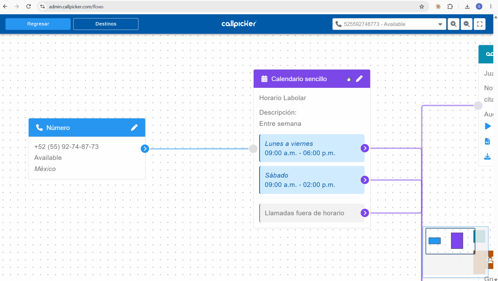

## Antes de empezar

<Info>
  - Para cambiar a dónde va la llamada, consulta [Cambia a dónde dirige un bloque destino](/cambia-a-donde-dirige-un-bloque-destino).
  - Algunos destinos no se editan en Flujo. Consulta [Administra destinos fuera de Flujo](/administra-destinos-fuera-de-flujo).
</Info>

## Elige dónde editar

<Tabs>
  <Tab title="Flujo">
    **Desde el bloque destino**

    <Steps>
      <Step title="Ubica el bloque destino">
        Busca en el flujo el bloque destino que quieres editar.
      </Step>
      <Step title="Abre la edición">
        Haz clic en el ícono de editar (lápiz) en la esquina superior derecha del bloque destino.
      </Step>
      <Step title="Modifica la configuración">
        Cambia los campos que necesites, por ejemplo el nombre, el correo de notificación o los horarios.
      </Step>
      <Step title="Guarda los cambios">
        Haz clic en **Guardar**, al final del proceso.
      </Step>
    </Steps>

    **Desde el botón Destinos**

    <Steps>
      <Step title="Abre Destinos">
        Haz clic en el botón **Destinos**, en la barra superior (header) de Flujo.
      </Step>
      <Step title="Selecciona el tipo de destino">
        En la barra lateral que se abre, selecciona el tipo de destino que quieres editar.
      </Step>
      <Step title="Edita o crea">
        En el listado, edita un destino existente o crea uno nuevo.
      </Step>
      <Step title="Guarda los cambios">
        Si editaste un destino, haz clic en **Guardar**, al final del proceso.
      </Step>
    </Steps>
  </Tab>
  <Tab title="Destinos">
    <Steps>
      <Step title="Abre el tipo de destino">
        En **Destinos**, haz clic en el tipo de destino que quieres editar, por ejemplo [Extensiones](https://admin.callpicker.com/extensions).
      </Step>
      <Step title="Abre la edición">
        En la tarjeta del destino, haz clic en el ícono de editar (lápiz) junto a su nombre. En **Agentes Virtuales**, haz clic en **Editar**. Se abre una ventana de edición.
      </Step>
      <Step title="Modifica la configuración">
        Cambia los campos que necesites.
      </Step>
      <Step title="Confirma los cambios">
        Haz clic en el botón de la parte inferior derecha de la ventana. Su nombre depende del tipo de destino:

        | Tipo de destino | Ventana | Botón |
        |---|---|---|
        | Extensiones | **Editar extensión** | **Guardar** |
        | Buzones de voz | **Editar buzón** | **Guardar** |
        | Calendarios | **Editar calendario** | **Enviar** |
        | Grupos de extensiones | **Editar Grupo** | **Continuar** y luego **Guardar** |
        | Agentes Virtuales | **Editar agente virtual** | **Continuar**, **Continuar** y luego **Guardar** |

        Para salir sin cambios, haz clic en **Cancelar**.
      </Step>
    </Steps>

    <AccordionGroup>
      <Accordion title="Pantallas de Editar Grupo">
        1. Nombre del grupo, correo(s) de alertas, **Si nadie contesta**, **Timbrado** y **Tiempo de timbrado**. Haz clic en **Continuar**.
        2. **Extensiones en el grupo**: busca y selecciona las extensiones del grupo. Haz clic en **Guardar**, o en **Regresar** para volver a la pantalla anterior.
      </Accordion>
      <Accordion title="Pantallas de Editar agente virtual">
        1. Nombre, modelo, idioma, voz, **Opciones avanzadas** e **Inicio de la conversación**. Haz clic en **Continuar**.
        2. **Instrucciones para el agente virtual (prompt)** y **Acciones**, donde puedes editar, borrar o agregar acciones con **+ Nueva acción**. Haz clic en **Continuar**.
        3. **Confirmación**: muestra el resumen del agente (idioma, voz y modelo). Haz clic en **Guardar**.

        <Warning>
          En **Seleccionar modelo**, al elegir algunos modelos se genera un costo adicional en tu siguiente factura.
        </Warning>
      </Accordion>
    </AccordionGroup>

    <Note>
      **Menús** no tienen un lápiz junto al nombre. Cada sección de la tarjeta tiene su propio lápiz, por ejemplo **Destino si no elige opción**, **Opciones** o **Tus clientes escucharán**, y al hacer clic solo editas esa sección. Las secciones que no tienen lápiz y muestran **Ver en flujo** solo se editan desde Flujo.
    </Note>
  </Tab>
</Tabs>

## Casos específicos

<AccordionGroup>
  <Accordion title="Calendario sencillo">
    Para ver los horarios de atención, haz clic en el ícono de editar (lápiz) del bloque destino del calendario y luego en **Continuar**, en la parte inferior derecha de la barra lateral.

    <Frame>
      
    </Frame>
  </Accordion>
  <Accordion title="Extensión dentro de un grupo">
    En el bloque destino del grupo de extensiones, haz clic en el lápiz de la fila de la extensión para editar esa extensión.
  </Accordion>
</AccordionGroup>

## Ver también

<Columns cols={2}>
  <Card title="Cambia a dónde dirige un bloque destino" icon="route" href="/cambia-a-donde-dirige-un-bloque-destino" horizontal />
  <Card title="Cambia un audio de tus llamadas" icon="volume-2" href="/cambia-un-audio-de-tus-llamadas" horizontal />
</Columns>
