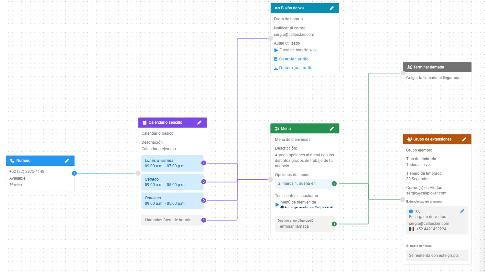

## Antes de empezar

<Info>
  Necesitas:

  - Una cuenta con la configuración predeterminada de Flujo.
  - Un teléfono con un número distinto al que configuraste para recibir llamadas. Si llamas desde ese mismo número, la llamada sonará en tu mismo celular.
</Info>

En este tutorial vas a abrir Flujo, seguir el recorrido de una llamada, cambiar el correo donde recibes los mensajes del buzón de voz y probar el recorrido con una llamada.

## Pasos

<Steps>
  <Step title="Abre Flujo">
    En Admin Callpicker, haz clic en la opción **Flujo**.
  </Step>
  <Step title="Identifica los bloques destino">
    Verás estos bloques destino:

    

    | Bloque destino | Color | Qué muestra |
    |---|---|---|
    | Número | <span className="hc-color"><span className="hc-dot hc-dot-azul"></span> Azul</span> | Tu número (DID), su estado y su país |
    | Calendario sencillo | <span className="hc-color"><span className="hc-dot hc-dot-morado"></span> Morado</span> | Horarios de lunes a viernes, sábado y domingo, y el enrutamiento para las **Llamadas fuera de horario** |
    | Menú | <span className="hc-color"><span className="hc-dot hc-dot-verde-olivo"></span> Verde olivo</span> | Un mensaje de bienvenida con audio generado con Callpicker AI, la opción **Si marca 1, suena en:** y **Destino si no elige opción** |
    | Grupo de extensiones | <span className="hc-color"><span className="hc-dot hc-dot-cafe"></span> Café</span> | Tipo y tiempo de timbrado, correos de alertas, extensiones del grupo y qué pasa si nadie contesta |
    | Buzón de voz | <span className="hc-color"><span className="hc-dot hc-dot-turquesa"></span> Turquesa</span> | Correo de notificación y audio para llamadas fuera de horario |
    | Terminar llamada | <span className="hc-color"><span className="hc-dot hc-dot-gris"></span> Gris</span> | Cuelga la llamada al llegar aquí |
  </Step>
  <Step title="Sigue el recorrido de una llamada">
    1. En el bloque destino **Número**, haz clic en el botón circular con flecha (nodo conector) que está en el borde derecho del bloque, al inicio de la línea que lo conecta con el siguiente.
    2. Aparece un recuadro con el nombre del siguiente bloque destino. Haz clic en él y la línea te lleva a ese bloque, en este caso el **Calendario sencillo**.
    3. Repite estas dos acciones en cada bloque destino para seguir el recorrido. Si un bloque tiene varios botones con flecha (por ejemplo, uno por horario o uno por opción del menú), cada uno lleva a su propio destino.

    El flujo de llamadas predeterminado es el siguiente:

    - Suena en tu **Número**.
    - Las llamadas dentro de horario pasan al **Menú**.
    - Las llamadas fuera de horario pasan al **Buzón de voz**.
    - La opción 1 del menú lleva al **Grupo de extensiones**.
    - Si la persona no elige opción, la llamada va a **Terminar llamada**.
    - Si nadie contesta en el grupo, se reintenta con el mismo grupo.

    ```mermaid
    flowchart LR
      N[Número] --> C[Calendario sencillo]
      C -- Dentro de horario --> M[Menú]
      C -- Fuera de horario --> B[Buzón de voz]
      M -- Si marca 1 --> G[Grupo de extensiones]
      M -- No elige opción --> T[Terminar llamada]
      G -- Nadie contesta: reintento --> G
    ```
  </Step>
  <Step title="Cambia el correo del buzón de voz">
    1. Haz clic en el ícono de editar (lápiz) en la esquina superior derecha del bloque destino **Buzón de voz**.
    2. Cambia el correo de notificación por el correo donde quieres recibir los mensajes que te dejen.
    3. Haz clic en **Guardar**, en la parte inferior derecha de la barra lateral de edición.

    El bloque destino **Buzón de voz** muestra ahora el correo nuevo. Si quieres volver al anterior, repite este paso con ese correo.
  </Step>
  <Step title="Revisa tu horario de atención">
    En el bloque destino **Calendario sencillo**, revisa tus horarios de atención.

    Haz la llamada de prueba dentro de ese horario. Fuera de él, la llamada se va al **Buzón de voz** y no pasa por el menú.
  </Step>
  <Step title="Prueba el recorrido con una llamada">
    Desde tu otro teléfono, llama al número que aparece en el bloque destino **Número**.

    1. Escucharás el mensaje de bienvenida del menú.
    2. Marca 1.
    3. La llamada timbra en las extensiones del grupo.
  </Step>
</Steps>

<Check>
  Abriste Flujo, seguiste el recorrido de una llamada, cambiaste el correo de notificación del buzón de voz y comprobaste el recorrido con una llamada.
</Check>

## Qué sigue

<Columns cols={2}>
  <Card title="Cambia a dónde dirige un bloque destino" icon="route" href="/cambia-a-donde-dirige-un-bloque-destino" horizontal />
  <Card title="Crea un grupo de extensiones" icon="users" href="/crea-un-grupo-de-extensiones" horizontal />
  <Card title="Crea un menú (IVR) con audio generado por IA" icon="list" href="/crea-un-menu-ivr-con-audio-ia" horizontal />
  <Card title="Controles de la interfaz de Flujo" icon="mouse" href="/controles-de-la-interfaz-de-flujo" horizontal />
</Columns>
